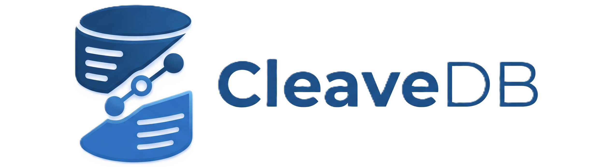
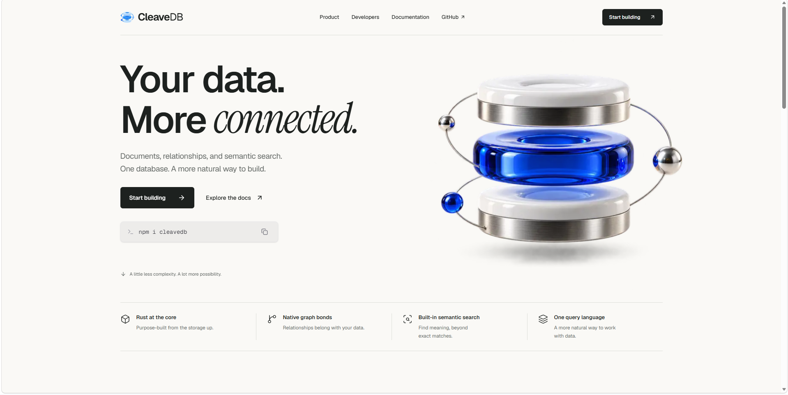

<div align="center">
  
  <br/><br/>
  <p><strong>A database for documents, connected data, and semantic search.</strong></p>


  [](https://www.python.org/downloads/)
  [](https://doc.rust-lang.org/edition-guide/rust-2021/index.html)
  [](https://github.com/Tribrix23/CleaveDB/blob/main/LICENSE)
  [](https://www.npmjs.com/package/cleavedb)
</div>

<br/>

## Overview

**CleaveDB** combines document storage, relational queries, graph traversal, and semantic search in a single database. Store JSON documents in buckets, connect them through native relationships called **bonds**, and query both their contents and their connections with **CleaveQL**, an English-like query language.

Built on a custom **Rust storage engine**, CleaveDB brings these capabilities together so you can work with structured data, explore relationships, and find relevant information by meaning within the same system.

- **Flexible document storage:** Organize JSON documents in buckets and query their fields.
- **Connected data:** Create native graph bonds and follow relationships across documents and buckets.
- **Search by meaning:** Use Transformer embeddings to discover relevant documents beyond exact keyword matches.
- **Unified querying:** Read, write, filter, sort, aggregate, and traverse data with CleaveQL.

Visit the [CleaveDB website](https://cleavedb.devctr.com/) for documentation and getting started.

[](https://cleavedb.devctr.com/)

## 💾 Installation

### Option A: Windows Installer (Recommended)

Choose the release stream appropriate for your environment:

| Release Stream | Status | Installer Package | SHA-256 Checksum | Recommended For |
| :--- | :--- | :--- | :--- | :--- |
| **Stable Release** | `v4.0.1` | `CleaveDB-v4.0.1-Setup.exe` | `e3af1b76679c34eaf20aaf0be1824bc6ca576949b7add7f2d14c830a946f4489` | Production environments & mission-critical deployments |
| **Preview Release** | `v4.0.2-beta` | `CleaveDB-v4.0.2-Setup.exe` | `a08a552f8ab59f3f770e0dbc18c0996760d73a75c458145d0619dccdc498275b` | Testing distributed sharding, real-time telemetry, & catalog updates |

The Windows installer bundles the interactive **CleaveShell CLI**, the TCP engine server, the Go distributed coordinator, and native hardware-accelerated SIMD / Rust storage modules — no manual Python, Rust, or C++ toolchain setup is required.

#### 1. Download & Verify Checksum
1. Download the installer for your desired release stream from the [Releases](https://github.com/Tribrix23/CleaveDB/releases) page.
2. In PowerShell, verify the cryptographic integrity of the downloaded installer:
   ```powershell
   Get-FileHash .\CleaveDB-v4.0.1-Setup.exe -Algorithm SHA256   # For Stable (v4.0.1)
   Get-FileHash .\CleaveDB-v4.0.2-Setup.exe -Algorithm SHA256   # For Preview (v4.0.2-beta)
   ```
   **Official Release Checksums:**  
   - **`v4.0.1` (Stable):** `e3af1b76679c34eaf20aaf0be1824bc6ca576949b7add7f2d14c830a946f4489`  
   - **`v4.0.2-beta` (Preview):** `a08a552f8ab59f3f770e0dbc18c0996760d73a75c458145d0619dccdc498275b`

#### 2. Install
- **Interactive Setup:** Double-click the installer executable and follow the guided setup wizard.
- **Silent / Automated Deployment:**
  ```powershell
  .\CleaveDB-v4.0.1-Setup.exe /VERYSILENT /SUPPRESSMSGBOXES /NORESTART
  ```

> [!NOTE]
> **Windows SmartScreen & Unsigned Binary Notice**  
> CleaveDB is an independent open-source project. Newly published releases do not carry an enterprise EV (Extended Validation) code-signing certificate and may trigger a Windows SmartScreen warning (*"Windows protected your PC"*) until community download volume builds reputation.  
> **Always verify that the SHA-256 checksum matches the published hash above** before selecting *More info* → *Run anyway*.

*(Once installed, launch `CleaveShell` directly from your Start Menu / Terminal, or connect via the NPM Client!)*

---

### Option B: Compile from Source (Advanced / Contributors)
If you want to contribute or modify the core engine, you can compile CleaveDB from source.

**Prerequisites:**
- **Python 3.10+** (tested on 3.10 through 3.13)
- **Rust Toolchain** (2021 edition via [rustup.rs](https://rustup.rs/))
- **C++ Build Tools** (MSVC or GCC with AVX-512 support)
- **Go 1.20+** (for distributed coordinator logic)

**1. Clone & Install Python Dependencies**
```bash
git clone https://github.com/Tribrix23/CleaveDB.git
cd CleaveDB
pip install -r requirements.txt
```

**2. Run the Master Build Script**
The orchestrator script compiles the C++ SIMD layers, the Go Coordinator, and the Rust storage engine via PyO3/maturin:
```bash
python build.py
```

**3. Launch the Server & Shell**
```bash
# Start the TCP database server (ports 8301, 8302, 8303)
python cleavedb_server.py

# In a separate terminal, launch the interactive shell
python cleave_cli.py
```

---

## 📄 License & Commercial Usage

CleaveDB is licensed under the [Apache License, Version 2.0](LICENSE).

- **Commercial Use:** You are free to run, modify, embed, and deploy CleaveDB within commercial software and proprietary products without royalty or license fees.
- **Attribution & Notice:** Any redistribution of the source code or binary derivatives must preserve the original copyright notice and a copy of the Apache 2.0 License.
- **Patents:** Includes an explicit contributor grant of patent rights from contributors.

